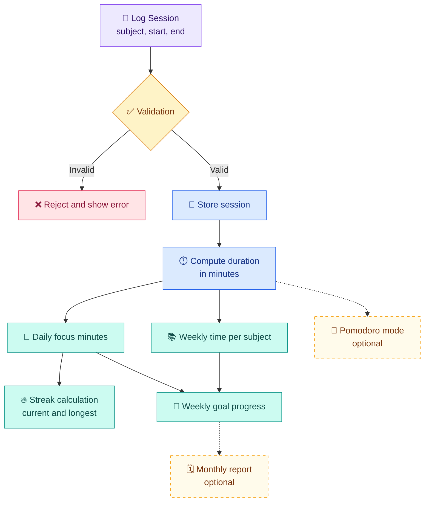
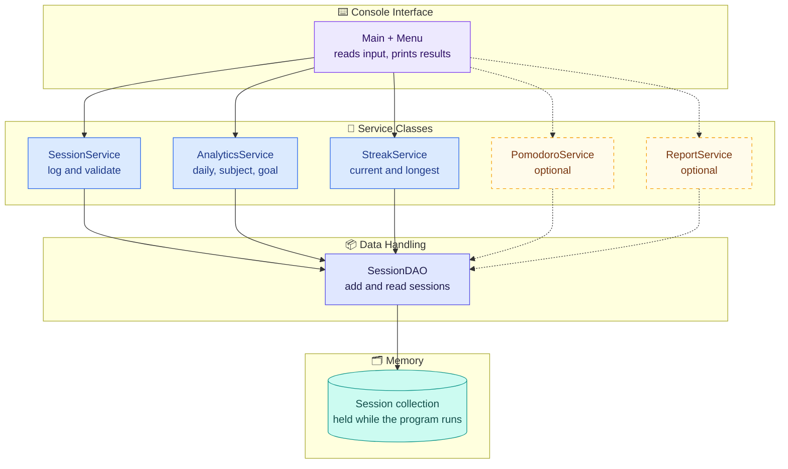

# ⏱️ FocusFlow

### Study Session Analytics and Streak Tracker


> **Consistency beats cramming.**

FocusFlow is a **pure console-based Java application** that helps students preparing for placements see whether their study time is actually consistent. Log study sessions, then view daily focus minutes, weekly time per subject, current and longest study streaks, and progress against a weekly goal.

It has no graphical interface, web page, server or database. Everything runs in the terminal using only the standard Java library.

---

## 📌 Overview and Problem Statement

### The problem

Students preparing for placements often *feel* like they study regularly, but without measurement they cannot tell. Long gaps, last-minute cramming and one over-studied subject all stay hidden. Without feedback on consistency, it is hard to build a habit or to balance preparation across subjects.

### The solution

FocusFlow records each study session (subject, start time, end time) and derives all analytics from that single log: daily focus minutes, weekly time per subject, daily study streaks and weekly goal progress.

### Objectives

| # | Objective |
|---|-----------|
| 1 | Record study sessions accurately with subject, start and end time |
| 2 | Show how many focus minutes were studied each day |
| 3 | Show how weekly study time is split across subjects |
| 4 | Measure consistency with current and longest daily streaks |
| 5 | Let the user set a weekly goal and track progress toward it |

---

## ✨ Core Features

All five core features are compulsory parts of the project scope.

| # | Feature | Description |
|:-:|---------|-------------|
| 1 | 📝 **Log study sessions** | Record a session with subject, start time and end time |
| 2 | 📅 **Daily focus minutes** | Total minutes studied on each day |
| 3 | 📚 **Time per subject (weekly)** | Minutes per subject for a reporting week |
| 4 | 🔥 **Study streaks** | Current and longest run of consecutive study days |
| 5 | 🎯 **Weekly goal and progress** | Set a weekly target and see progress toward it |

## 🌟 Stretch Features (Optional)

> [!NOTE]
> Stretch features are **optional extensions**. They are described here as design, and should be marked as implemented only if they exist in your code.

| Feature | Description |
|---------|-------------|
| 🍅 **Pomodoro mode** | 25-minute focus sessions, with break reminders counted |
| 🗓️ **Monthly report** | Summary of a month, identifying the best and worst week |

---

## ⚙️ How It Works

**Log session → validate → store → aggregate by day, subject and week → calculate streaks → show goal progress.**



Dashed boxes are **optional** stretch features.

**Validation rules (design)**

| Field | Rule |
|-------|------|
| Subject | Required, non-blank (compared ignoring letter case) |
| Start and end time | Valid date and time values |
| Time order | End time must be after start time |
| Overlap | A session may not overlap an existing one, so minutes are never double counted |
| Weekly goal | Positive number of minutes |

---

## 🔥 Streak Rules

Streaks depend on a few precise definitions, stated here so results are predictable.

| Term | Definition |
|------|------------|
| **Study day** | A calendar day with at least the minimum focus minutes (default **1 minute**, configurable) |
| **Session date** | A session counts toward the day on which it **starts** |
| **Current streak** | Consecutive study days ending **today**; if today has no study yet, it ends **yesterday** so the streak is not lost until the day is over |
| **Longest streak** | The longest run of consecutive study days anywhere in the history |

```text
no study today and none yesterday  ->  current streak = 0
longest streak >= current streak   (always)
```

> [!NOTE]
> The minimum-minutes threshold, the start-date attribution rule and the "grace until the end of today" rule are **design decisions** made for this project, not fixed standards. Change them to match your implementation.

---

## 🛠️ Technology Stack

| Technology | Purpose |
|------------|---------|
|  | Core application logic: sessions, analytics, streaks and goals |
|  | Text menu using standard input and output (`Scanner`, `System.out`) |
|  | Dates, durations, day and week boundaries |
|  | In-memory session storage and grouping by day, week and subject |
|  | Version control and repository hosting |
|  | Development environment |

No external libraries or frameworks are required.

---

## 🏗️ Application Structure

The program is a single console application organised into small classes with separate responsibilities.

> [!NOTE]
> Class names below are **proposed**. Rename them to match your code.



| Component | Responsibility |
|-----------|----------------|
| Main and menu | Show the text menu, read input, print analytics |
| `SessionService` | Validate and record study sessions |
| `AnalyticsService` | Daily minutes, weekly time per subject, weekly goal progress |
| `StreakService` | Current and longest daily streak |
| `PomodoroService` *(optional)* | 25-minute sessions and break-reminder count |
| `ReportService` *(optional)* | Monthly report with best and worst week |
| `SessionDAO` | Add and read sessions from the collection |
| Session collection | Holds sessions in memory while the program runs |

---

## 🗃️ Data Model

| Field | Type | Description |
|-------|------|-------------|
| `session_id` | Integer | Unique session identifier |
| `subject` | String | Subject studied (for example DSA, DBMS, Aptitude) |
| `start_time` | Date and time | When the session began |
| `end_time` | Date and time | When the session ended |

**Derived values** such as duration, session date, week and streaks are calculated at runtime and never stored, so they cannot become inconsistent with the log.

```text
duration_minutes = minutes between start_time and end_time
```

The **weekly goal** is a single setting: a target number of focus minutes per week, applied to every week until the user changes it.

---

## 🧮 Algorithms and Technical Concepts

| Concept | Use in FocusFlow |
|---------|------------------|
| **Duration calculation** | Minutes between start and end, using `java.time` |
| **Group-and-sum aggregation** | Sessions grouped by date (daily minutes) and by subject (weekly time) |
| **Date-keyed map** | A date-to-minutes map kept in date order, which makes streak scanning simple |
| **Linear streak scan** | Walk study days in order, extending a run when a day follows the previous one |
| **Week-boundary logic** | Assign each session to a Monday-start reporting week |
| **Interval validation** | Reject sessions whose end is not after the start, or that overlap another |
| **Progress calculation** | Weekly minutes divided by goal minutes |

### Time complexity

For `n` logged sessions:

- Grouping into daily or subject totals is a single pass, `O(n)` with a hash map.
- Keeping totals in date order with a sorted map costs `O(n log n)` overall.
- Scanning `d` distinct study days for streaks is `O(d)`.

All of this is trivial at the scale of a student's personal log.

---

## 📈 Metrics and Definitions

| Metric | Definition |
|--------|------------|
| **Daily focus minutes** | Sum of `duration_minutes` of all sessions that start on that date |
| **Reporting week** | Monday 00:00:00 (inclusive) to the following Monday 00:00:00 (exclusive), in the system's default time zone |
| **Time per subject (week)** | Sum of `duration_minutes` per subject for sessions starting in the reporting week |
| **Current streak** | Consecutive study days ending today (or yesterday), as defined in [Streak Rules](#-streak-rules) |
| **Longest streak** | Longest run of consecutive study days in the whole history |

### Weekly goal progress

$$\text{Progress \%} = \frac{\text{focus minutes in the reporting week}}{\text{weekly goal in minutes}} \times 100$$

```text
progress_percentage = (week_focus_minutes / weekly_goal_minutes) * 100
remaining_minutes   = max(0, weekly_goal_minutes - week_focus_minutes)
```

- **Reporting period:** one reporting week, by default the current one.
- **Denominator:** the weekly goal, which must be greater than zero.
- **Over the goal:** progress may exceed 100%; remaining minutes never go below zero.
- **No goal set:** the program asks the user to set one instead of showing a percentage.

*Illustrative example (not project data): with a goal of 300 minutes and 180 minutes studied this week, progress is 180 / 300 × 100 = 60% with 120 minutes remaining.*

### Stretch feature definitions (optional)

| Feature | Definition |
|---------|------------|
| **Pomodoro session** | A 25-minute focus block. Break length is not fixed by the project brief, so choose and document your own (for example 5 minutes) |
| **Break reminders counted** | The number of break reminders shown during Pomodoro sessions |
| **Monthly report** | Weekly focus minutes for each Monday-start week of a calendar month, counting only days inside that month |
| **Best and worst week** | Highest and lowest weekly totals in the month; ties go to the earlier week |

---

## 🖥️ Using the Console App

The program is driven by a numbered text menu. Each core feature maps to a menu action:

| Feature | What you do |
|---------|-------------|
| Log a session | Enter subject, start time and end time |
| Daily focus minutes | View minutes studied per day |
| Weekly subject time | View minutes per subject for a week |
| Streaks | View current and longest streak |
| Weekly goal | Set a goal and view progress |
| Exit | Quit the program |

> [!NOTE]
> Menu numbering and wording may differ in your version. Edit this table to match your actual menu, and add rows for Pomodoro mode or the monthly report only if you implement them.

---

## 🚀 Getting Started

> [!NOTE]
> Repository details, package names and the main class below are **placeholders**. Replace them with your actual values.

### Prerequisites

| Requirement | Version |
|-------------|---------|
| JDK | 17 |
| Git | Any recent version |
| VS Code | Optional, with the *Extension Pack for Java* |

Verify your Java installation:

```bash
java -version
javac -version
```

### 1. Clone the repository

```bash
git clone https://github.com/<your-username>/<your-repository>.git
cd <your-repository>
```

### 2. Compile

```bash
# macOS / Linux
mkdir -p out
find src -name "*.java" > sources.txt
javac -d out @sources.txt
```

```bat
:: Windows (Command Prompt)
mkdir out
dir /s /b src\*.java > sources.txt
javac -d out @sources.txt
```

### 3. Run

```bash
java -cp out <your.package.MainClass>
```

Nothing else needs to be installed or started. The program runs in your terminal and is controlled through its text menu.

> [!TIP]
> In VS Code you can also open the main class and use **Run** above the `main` method.

### Suggested project layout

```text
<your-repository>/
├── src/
│   ├── model/      # StudySession
│   ├── service/    # SessionService, AnalyticsService, StreakService
│   ├── dao/        # SessionDAO
│   └── <package>/  # Main class and console menu
├── README.md
└── LICENSE
```

---

## 🔮 Future Enhancements

The items below are **ideas for future work**, not current features.

| Enhancement | Value |
|-------------|-------|
| 💾 File-based saving | Keep sessions between program runs |
| ⏲️ Live session timer | Start and stop a session instead of typing times |
| 📊 Text charts | Bar charts of daily minutes in the console |
| 📤 CSV export | Share or analyse the study log elsewhere |
| 🔍 Search and filtering | Filter sessions by subject or date range |
| 🏷️ Per-subject goals | Set separate weekly targets for each subject |
| 🔔 Study reminders | Nudge the user when a streak is at risk |

---

## 🎓 Learning Outcomes

| Concept | Demonstrated through |
|---------|----------------------|
| Modular design | Separate model, service and data-handling classes |
| Date and time handling | Durations, day boundaries, Monday-start weeks |
| Collections framework | Grouping and summing sessions by day, week and subject |
| Algorithm design | Linear streak scan over ordered study days |
| Input validation | Rejecting invalid or overlapping sessions |
| Metric definition | Clear rules for study day, reporting week and goal progress |
| Object-oriented programming | Classes with clear responsibilities |
| Engineering practice | Git workflow and documentation |

---

## 🤝 Contributing

1. Fork the repository.
2. Create a feature branch: `git checkout -b feature/<short-description>`
3. Commit with a clear message: `git commit -m "Add <feature>"`
4. Push the branch and open a pull request describing the change.

Please keep changes focused and update this README when behaviour or design changes.

## 📄 License

This project does not yet have a license. Choose an appropriate open-source license (for example [MIT](https://choosealicense.com/licenses/mit/) or [Apache-2.0](https://choosealicense.com/licenses/apache-2.0/)) via [choosealicense.com](https://choosealicense.com/), then add a `LICENSE` file and update this section.

---

## 🏁 Conclusion

FocusFlow turns scattered study hours into a clear picture of consistency: how much you studied, what you studied, how long your streak is, and whether you hit your goal.

**Show up every day. Let the streak do the rest.**


