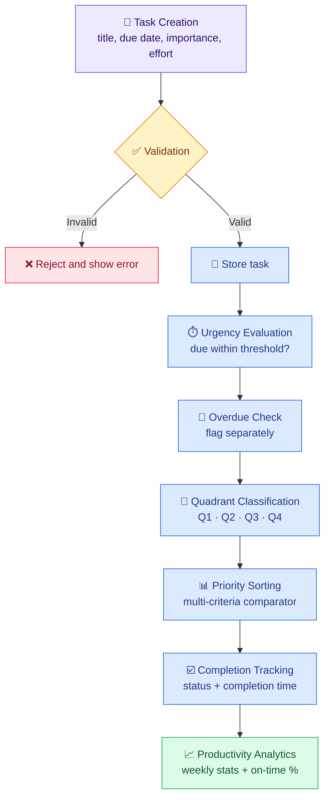
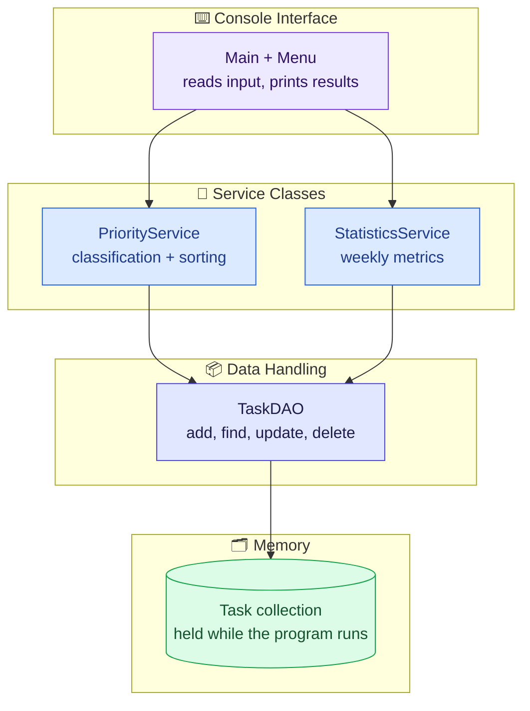

# Capstone-CP098- farhan & sushant
# 🎯 PriorityPro

### Eisenhower-Matrix Task Prioritisation Engine


> **Stop managing a list. Start managing your priorities.**

PriorityPro is a **pure console-based Java application** for students and professionals. It classifies every task into one of the four **Eisenhower Matrix** quadrants, ranks tasks by priority, flags overdue work, and turns completion history into weekly productivity metrics.

It has no graphical interface, web page, server or database. Everything runs in the terminal using only the standard Java library.

---

## 📌 Overview and Problem Statement

### The problem

Long to-do lists hide the difference between **urgent** tasks (a deadline is close) and **important** tasks (they matter for long-term goals). Without that distinction, people react to whatever is loudest, miss deadlines, and cannot tell whether their time is being used well.

### The solution

PriorityPro applies a **rule-based** version of the Eisenhower Matrix to each task's due date and importance, then sorts the task list using several criteria. It tracks completions and overdue work, and reports weekly productivity statistics, all from a simple text menu.

### Objectives

| # | Objective |
|---|-----------|
| 1 | Capture tasks with a title, due date, importance and estimated effort |
| 2 | Classify tasks into four quadrants automatically |
| 3 | Rank tasks with a deterministic, multi-criteria comparator |
| 4 | Track completion and surface pending overdue tasks |
| 5 | Report weekly completed-task counts and on-time completion percentage |

---

## ✨ Core Features

| Feature | Description |
|---------|-------------|
| ➕ **Add tasks** | Title, due date, importance and estimated effort (hours) |
| 🧭 **Auto-classification** | Each pending task is placed in one of four Eisenhower quadrants |
| 📊 **Priority sorting** | Ordered by overdue flag, quadrant, due date, importance and effort |
| ✅ **Completion tracking** | Mark tasks completed; list pending overdue tasks |
| 📈 **Weekly statistics** | Completed-task count and on-time completion percentage per week |

---

## 🧭 Eisenhower Matrix

|  | **Urgent** | **Not Urgent** |
|---|---|---|
| **Important** | 🟥 **Q1: Do First** | 🟦 **Q2: Schedule** |
| **Not Important** | 🟨 **Q3: Handle or Delegate** | ⬜ **Q4: Do Later or Eliminate** |

| Quadrant | Urgent | Important | Action |
|----------|:------:|:---------:|--------|
|  | Yes | Yes | Work on it now |
|  | No | Yes | Plan a time slot before it becomes urgent |
|  | Yes | No | Finish quickly or hand off |
|  | No | No | Defer or drop |

### How urgency and importance are decided

```text
urgent    = task is PENDING  AND  (due_date - now) <= urgency threshold
important = importance >= importance threshold
overdue   = task is PENDING  AND  due_date < now        (separate flag)
```

| Parameter | Default | Meaning |
|-----------|---------|---------|
| Urgency threshold | **24 hours** | A pending task due within this window is urgent |
| Importance scale | 1 (very low) to 5 (critical) | Entered by the user |
| Importance threshold | **4** | Importance at or above this value counts as important |

> [!NOTE]
> The **24-hour urgency threshold is a configurable design decision**, not an inherent rule of the Eisenhower Matrix. The matrix only defines the urgent/important split; each implementation chooses how to measure it. The importance threshold is likewise a configurable choice. Adjust both to match your own project's values.

### 🚩 Overdue tasks are flagged separately

Overdue is **not** a fifth quadrant. A pending task whose due date has passed is treated as urgent for classification (so it lands in Q1 or Q3 by importance) and also carries an independent **OVERDUE** flag. This keeps the four-quadrant model intact while making missed deadlines impossible to overlook. Completed tasks are not classified.

---

## ⚙️ How It Works

**Task creation → validation → urgency evaluation → quadrant classification → priority sorting → completion tracking → productivity analytics.**



**Validation rules**

| Field | Rule |
|-------|------|
| Title | Required, non-blank |
| Due date | Valid date and time (past dates are accepted and immediately flagged overdue) |
| Importance | Integer from 1 to 5 |
| Effort | Positive number of hours |

---

## 🛠️ Technology Stack

| Technology | Purpose |
|------------|---------|
|  | Core application logic: models, classification, sorting and statistics |
|  | Text menu using standard input and output (`Scanner`, `System.out`) |
|  | Date and time handling for deadlines, overdue detection and reporting weeks |
|  | In-memory task storage and sorting with comparators |
|  | Version control and repository hosting |
|  | Development environment |

No external libraries or frameworks are required.

---

## 🏗️ Application Structure

The program is a single console application organised into small classes with separate responsibilities.



| Component | Responsibility |
|-----------|----------------|
| Main and menu | Show the text menu, read user input, print sorted tasks, overdue list and statistics |
| `PriorityService` | Urgency evaluation, quadrant classification, priority sorting |
| `StatisticsService` | Weekly completed counts and on-time percentage |
| `TaskDAO` | Add, find, update and delete tasks in the collection |
| Task collection | Holds tasks in memory while the program runs |

---

## 🗃️ Data Model

Each task is represented by a `Task` object with the fields below. **Quadrant and overdue status are derived at runtime** from the due date, importance, status and current time, so they are never stored and cannot become stale.

| Field | Type | Description |
|-------|------|-------------|
| `task_id` | Integer | Unique task identifier |
| `title` | String | Task name |
| `due_date` | Date and time | Deadline (the time component enables the urgency threshold) |
| `importance` | Integer, 1 to 5 | User-assigned importance |
| `effort_hours` | Decimal | Estimated effort in hours |
| `status` | `PENDING` or `COMPLETED` | Current state |
| `created_at` | Date and time | Creation timestamp |
| `completed_at` | Date and time, optional | Set when the task is completed |

---

## 🧮 Algorithms and Technical Concepts

### Rule-based classification

Classification uses explicit rules rather than machine learning: two boolean tests (`urgent`, `important`) map to exactly one quadrant. The behaviour is transparent, testable and configurable through the thresholds above.

### Multi-criteria sorting

Pending tasks are ordered with a single comparator that applies these criteria in turn, moving to the next only on a tie:

| Order | Criterion | Direction |
|:-----:|-----------|-----------|
| 1 | Overdue flag | Overdue first |
| 2 | Quadrant | Q1, Q2, Q3, Q4 |
| 3 | Due date | Earliest first |
| 4 | Importance | Highest first |
| 5 | Estimated effort | Smallest first (quick wins) |

### Time complexity

Sorting with a comparator is comparison-based sorting, which has a typical time complexity of

$$O(n \log n)$$

for `n` tasks, and no comparison sort can do asymptotically better in the general case. Classification is a constant-time check per task, so total ranking cost is dominated by the sort.

### Deadline and overdue detection

Both are comparisons of the due date against the current time: a pending task is **urgent** if `due_date - now` is within the threshold, and **overdue** if `due_date < now`.

### CRUD operations (`TaskDAO`)

| Operation | Used for |
|-----------|----------|
| Create | Adding a task |
| Read | Listing pending, overdue and completed tasks |
| Update | Marking a task completed and recording its completion time |
| Delete | Removing a task |

### Weekly productivity calculations

`StatisticsService` counts completed tasks inside a reporting week and compares each completion time with its due date. Exact definitions follow in the next section.

---

## 📈 Productivity Metrics

### Definitions

| Term | Definition |
|------|------------|
| **Completed task** | A task with `status = COMPLETED` and a recorded `completed_at` |
| **Reporting week** | Monday 00:00:00 (inclusive) to the following Monday 00:00:00 (exclusive), in the system's default time zone |
| **Assigned to a week** | By `completed_at`, not by creation date or due date |
| **On-time task** | A completed task where `completed_at <= due_date` |

### On-time completion percentage

$$\text{On-Time \%} = \frac{\text{tasks completed in the week with } completed\_at \le due\_date}{\text{all tasks completed in the week}} \times 100$$

```text
on_time_percentage = (on_time_completed_in_week / total_completed_in_week) * 100
```

- **Reporting period:** one reporting week, as defined above.
- **Denominator:** all tasks **completed** in that week, whether on time or late.
- **No completions:** if the denominator is zero, the result is **N/A** rather than 0%.
- **Pending overdue tasks** are not in this denominator. They are reported separately in the overdue list so that unfinished work is not hidden.

*Illustrative example (not project data): if 8 tasks are completed in a week and 6 of them were finished by their due date, the on-time percentage is 6 / 8 × 100 = 75%.*

---

## 🖥️ Using the Console App

The program is driven by a numbered text menu. Each core feature maps to a menu action:

| Feature | What you do |
|---------|-------------|
| Add a task | Enter title, due date and time, importance (1 to 5) and effort in hours |
| View prioritised tasks | Display pending tasks sorted by priority with their quadrant |
| Complete a task | Select a task to mark it completed |
| View overdue tasks | List pending tasks whose due date has passed |
| View weekly statistics | See completed tasks and on-time percentage for a reporting week |
| Exit | Quit the program |

> [!NOTE]
> Menu numbering and wording may differ in your version. Edit this table to match your actual menu.

---

## 🚀 Getting Started

> [!NOTE]
> Repository details, package names and the main class below are **placeholders**. Replace them with your actual values.

### Prerequisites

| Requirement | Version |
|-------------|---------|
| JDK | 17 |
| Git | Any recent version |
| VS Code | Optional, with the *Extension Pack for Java* |

Verify your Java installation:

```bash
java -version
javac -version
```

### 1. Clone the repository

```bash
git clone https://github.com/<your-username>/<your-repository>.git
cd <your-repository>
```

### 2. Compile

```bash
# macOS / Linux
mkdir -p out
find src -name "*.java" > sources.txt
javac -d out @sources.txt
```

```bat
:: Windows (Command Prompt)
mkdir out
dir /s /b src\*.java > sources.txt
javac -d out @sources.txt
```

### 3. Run

```bash
java -cp out <your.package.MainClass>
```

Nothing else needs to be installed or started. The program runs in your terminal and is controlled through its text menu.

> [!TIP]
> In VS Code you can also open the main class and use **Run** above the `main` method.

### Suggested project layout

```text
<your-repository>/
├── src/
│   ├── model/      # Task, Quadrant
│   ├── service/    # PriorityService, StatisticsService
│   ├── dao/        # TaskDAO
│   └── <package>/  # Main class and console menu
├── README.md
└── LICENSE
```

---

## 🔮 Future Enhancements

The items below are **ideas for future work**, not current features.

| Enhancement | Value |
|-------------|-------|
| 💾 File-based saving | Keep tasks between program runs |
| 🔁 Recurring tasks | Automate daily, weekly or monthly routines |
| 🗓️ Daily planning within N hours | Select the top-ranked tasks that fit an available time budget using `effort_hours` |
| 🔔 Deadline notifications | Remind users before tasks become urgent |
| 📊 Productivity charts | Visualise weekly trends |
| 🔍 Search and filtering | Find tasks by title, quadrant, status or date range |
| 📆 Calendar integration | Sync deadlines with external calendars |
| 🔐 User authentication | Separate data per user with secure login |

---

## 🎓 Learning Outcomes

| Concept | Demonstrated through |
|---------|----------------------|
| Modular design | Separate model, service and data-handling classes |
| Rule-based decision logic | Urgent/important tests mapped to quadrants |
| Comparator design | Multi-criteria sorting and `O(n log n)` reasoning |
| Object-oriented programming | Classes with clear responsibilities |
| Collections framework | Storing, filtering and sorting tasks in memory |
| Date and time handling | Deadlines, overdue detection, reporting-week boundaries |
| Console input validation | Rejecting invalid input before it reaches the logic |
| Metric definition | Choosing a clear numerator, denominator and period |
| Engineering practice | Git workflow and documentation |

---

## 🤝 Contributing

1. Fork the repository.
2. Create a feature branch: `git checkout -b feature/<short-description>`
3. Commit with a clear message: `git commit -m "Add <feature>"`
4. Push the branch and open a pull request describing the change.

Please keep changes focused and update this README when behaviour or design changes.

## 📄 License

This project does not yet have a license. Choose an appropriate open-source license (for example [MIT](https://choosealicense.com/licenses/mit/) or [Apache-2.0](https://choosealicense.com/licenses/apache-2.0/)) via [choosealicense.com](https://choosealicense.com/), then add a `LICENSE` file and update this section.

---

## 🏁 Conclusion

PriorityPro turns a crowded to-do list into a clear plan: what to do now, what to schedule, what to hand off, and what to drop.

**Do what matters first. Measure what you finish.**


